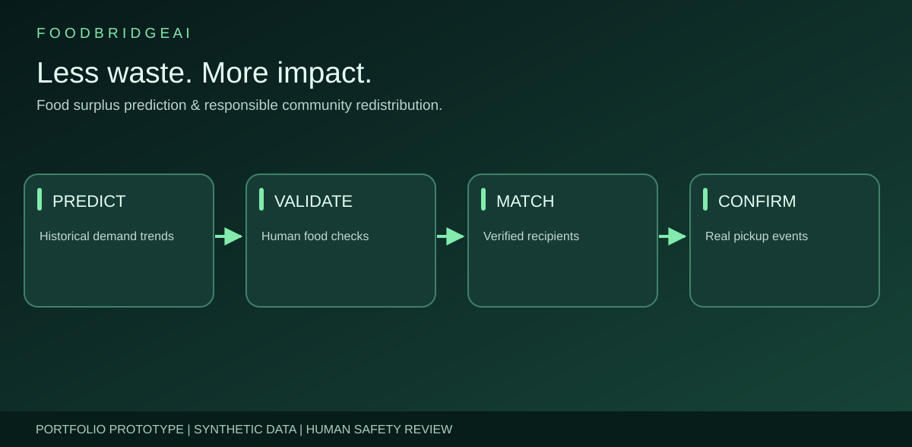
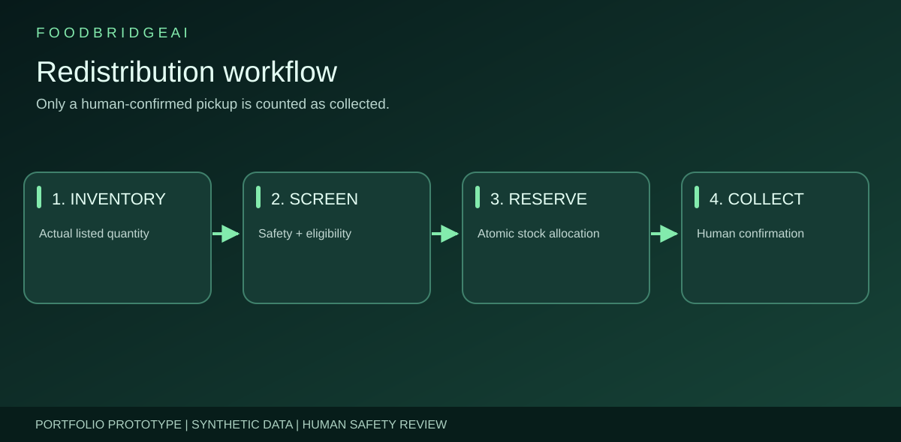
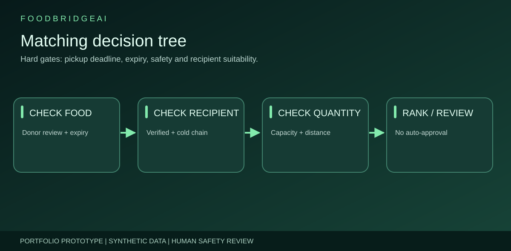
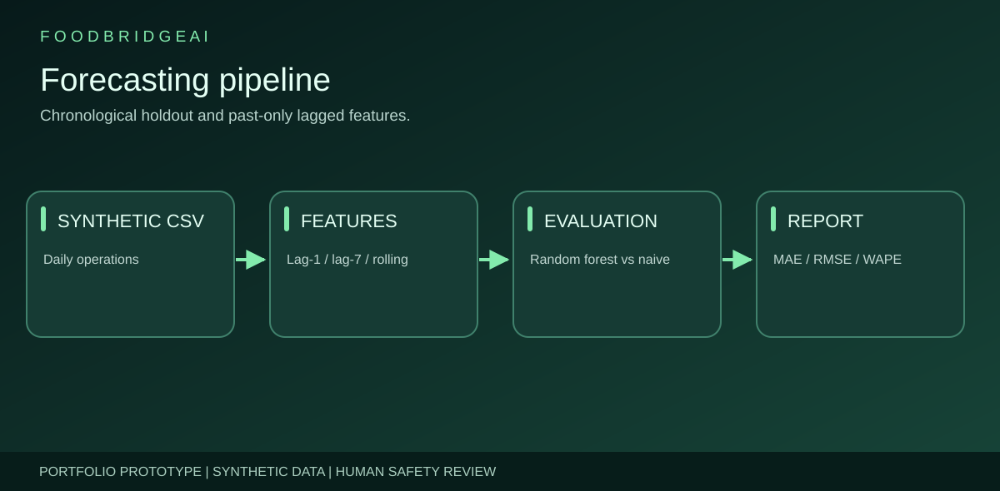
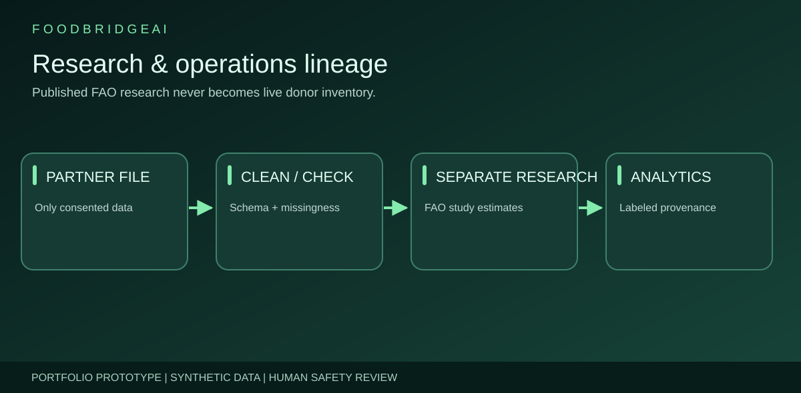
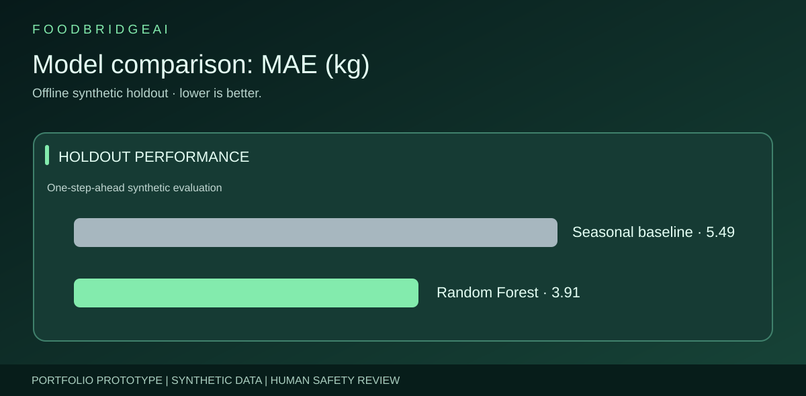
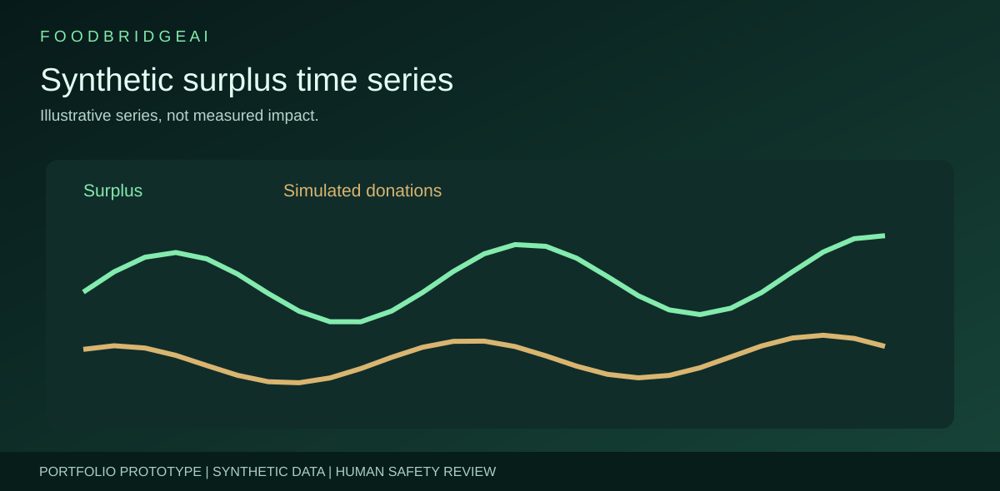
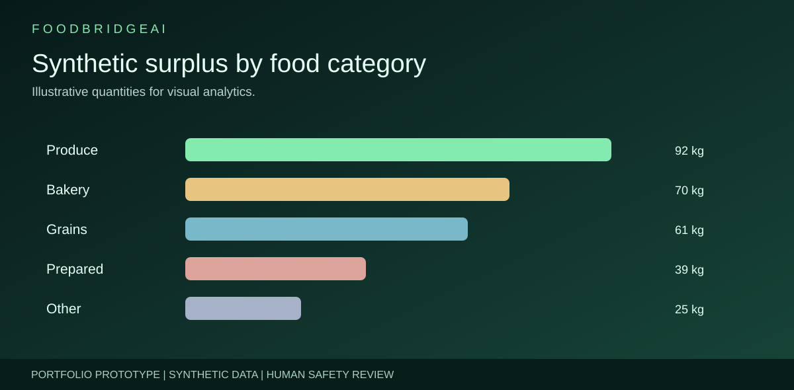
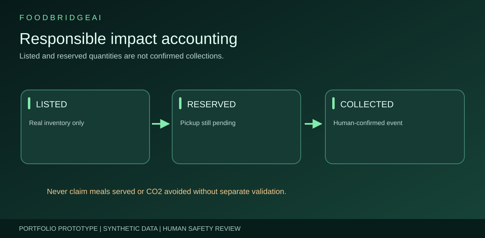
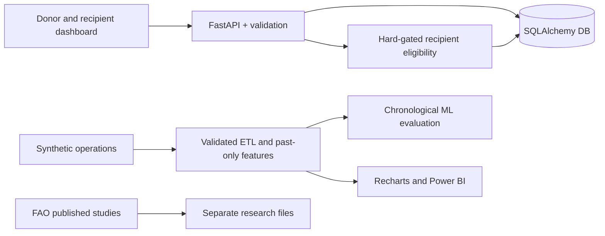

<div align="center">

<h1>🌱 FoodBridge AI</h1>
<p><strong>Food Waste Prediction & Community Redistribution</strong></p>
<p>Data science · FastAPI · SQLAlchemy · React · Recharts · Scikit-learn · Docker</p>
<p></p>
</div>

> [!IMPORTANT]
> **Educational portfolio prototype, not a live food donation service.** Sample partners and historical records are fictional. No real food is being supplied, no food-safety determination is automated and no avoided-waste / meals-served impact is independently verified. Predictions are not physical inventory; any donation requires authorized human review and confirmation.

[](https://github.com/harshakavali81-collab/FoodBridge-AI-Food-Waste-Prediction-Community-Redistribution/actions/workflows/ci.yml)

## What is FoodBridge AI?
A portfolio-ready local application for understanding possible food surplus, recording actually available inventory, screening potential recipient organizations, reserving stock safely, and tracking confirmations separately from forecasts and reservations.

| Area | Demonstration |
|---|---|
| Dashboard | Available, reserved, confirmed-collected kilograms + synthetic trends |
| Donor inventory | Items, quantities, allergens, storage, pickup deadlines and donor safety acknowledgment |
| Recipients | Demo capacity, category, cold-chain compatibility, distance and verification flag |
| Smart matching | Rule-based hard gates with candidate ranking by approximate proximity |
| Donation tracking | Atomic stock allocation, cancellation and explicit confirmation |
| ML & analytics | Time-aware random forest vs seasonal-naive baseline; synthetic dataset and Power BI guide |
| Engineering | API docs, 22 passing automated tests, Docker, GitHub Actions, 10 original SVG assets |

## Visual project tour — 10 original diagrams & charts

| System architecture | Donation lifecycle |
|---|---|
|  |  |
| Eligibility decision tree | Machine-learning pipeline |
|  |  |
| Research and operations lineage | Model comparison (illustrative example) |
|  |  |
| Synthetic time-series | Synthetic category mix |
|  |  |
| Responsible impact accounting | Banner |
|  |  |

The model comparison image rounds the verified synthetic-data evaluation (Random Forest 3.908 kg MAE versus lag-7 baseline 5.49 kg MAE); these figures do not generalize to live food operations. These pictures are illustrations, not verified real-world donations.

## Run locally — Docker (recommended)
```bash
cp .env.example .env
docker compose up --build
```
Frontend: **http://localhost:3000** · API: **http://localhost:8000/docs**. The Compose services bind to localhost intentionally.

## Run manually
```bash
python -m venv .venv
# Linux/macOS: source .venv/bin/activate
# Windows PowerShell: .venv\Scripts\Activate.ps1
pip install -r requirements.txt
python scripts/generate_synthetic.py
PYTHONPATH=.:src uvicorn backend.app.main:app --reload --port 8000
```
For PowerShell, set `$env:PYTHONPATH='.;src'` and then run `uvicorn backend.app.main:app --reload --port 8000`.

Second terminal:
```bash
cd frontend
npm install
npm run dev
```
Open **http://localhost:5173**. Requirements: Python 3.12+, Node 22+.

## Train and evaluate
```bash
PYTHONPATH=.:src python -m foodbridge.forecasting.train --data data/synthetic/daily_operations.csv --output models
cat models/evaluation.json
PYTHONPATH=.:src python -m pytest -q
```

**Method:** Past-only lag-1, lag-7 and 7-day rolling historical surplus; chronological 80/20 date split; Random Forest vs lag-7 baseline; report MAE, RMSE and WAPE. Test lag features require observed history, so this is an offline one-step-ahead evaluation, **not** a real multi-day autonomous forecast. API forecast preview is explicitly a 7-day moving-average baseline.

## Architecture


## Project structure
```text
FoodBridge AI/
├── backend/app/          FastAPI, schemas, SQLAlchemy models & four route modules
├── frontend/src/         React dashboard, six pages, matching and donation forms
├── src/foodbridge/       Ingestion, processing, forecasting, matching, monitoring
├── data/synthetic/       840-row reproducible synthetic history
├── notebooks/            EDA / forecasting / redistribution analysis
├── scripts/              Data generator and optional matplotlib charts
├── tests/                API, ML-feature and safety-match tests
├── docs/assets/          Ten distinct original SVG project visuals
├── docs/                 Architecture, workflows, safety, data and deployment
├── portfolio/            Static portfolio case study
├── powerbi/              Report blueprint + DAX
└── .github/workflows/    Backend and frontend CI
```

## API highlights
```text
GET  /api/v1/health
GET  /api/v1/dashboard
GET  /api/v1/inventory
POST /api/v1/inventory
GET  /api/v1/recipients
POST /api/v1/recipients
GET  /api/v1/matches/{inventory_id}
POST /api/v1/donations
POST /api/v1/donations/{id}/confirm
POST /api/v1/donations/{id}/cancel
GET  /api/v1/analytics/trends
GET  /api/v1/analytics/export.csv
GET  /api/v1/forecast/preview
```

The `X-API-Key` option gates write operations if configured. It is **not sufficient production authentication** and should never be treated as tenant-level user management.

## Portfolio static hosting

The public static bundle contains [an interactive synthetic demonstration](docs/demo.html) where visitors can filter fictional inventory and simulate reservations without a backend, personal data, or actual donations. It is explicitly *not* the production React/FastAPI app.

A Pages-ready landing page is included at [docs/index.html](docs/index.html). The automated workflow packages the portfolio and interactive demo. **One-time owner action:** [Settings → Pages](https://github.com/harshakavali81-collab/FoodBridge-AI-Food-Waste-Prediction-Community-Redistribution/settings/pages) → **Build and deployment → Source: GitHub Actions**; then rerun the [Deploy portfolio website workflow](https://github.com/harshakavali81-collab/FoodBridge-AI-Food-Waste-Prediction-Community-Redistribution/actions/workflows/pages.yml). GitHub currently returns 404 for the deployment because Pages has not been enabled; no live URL is claimed.

## Closed, hardened staging environment

This repository also includes a **PostgreSQL API-only staging configuration**. In `APP_ENV=production`, it rejects operational writes even with a service key; reads require a strong server-only key, no demo records are seeded, and startup checks reject unsafe settings. The local React demo is NOT public production authentication. See [deployment commands and remaining release gates](docs/DEPLOYMENT.md), [security readiness](docs/SECURITY_READINESS.md), and [human partner/food-safety onboarding](docs/FOOD_SAFETY_AND_ONBOARDING.md).

## Documentation & portfolio
[Portfolio case study](portfolio/index.html) · [Architecture/ERD](docs/ARCHITECTURE.md) · [Project workflow](docs/PROJECT_WORKFLOW.md) · [Data dictionary](docs/DATA_DICTIONARY.md) · [Safety/limitations](docs/SAFETY_AND_LIMITATIONS.md) · [Deployment checklist](docs/DEPLOYMENT.md) · [Power BI](powerbi/README.md)

**Research source:** [FAO Food Loss and Waste Database](https://www.fao.org/platform-food-loss-waste/flw-data) is a source of published studies, **not** live donor inventory.

**Verified GitHub CI (2026-10-28):** 22 backend tests passed, model training/evaluation completed on synthetic data (MAE 3.908 kg vs 5.49 kg lag-7), static asset checks succeeded, and React production build succeeded. [Verified run](https://github.com/harshakavali81-collab/FoodBridge-AI-Food-Waste-Prediction-Community-Redistribution/actions/runs/40646825854). GitHub Pages and an actual public backend are **not deployed**, and no real partners or food safety operations have been verified.

---
Developed as an AI / ML, Python, SQL and full-stack portfolio project · © 2026 · MIT License.
