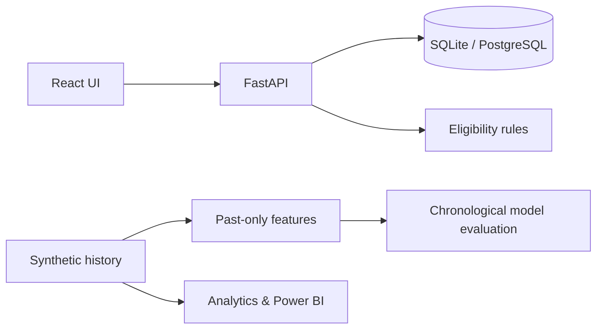
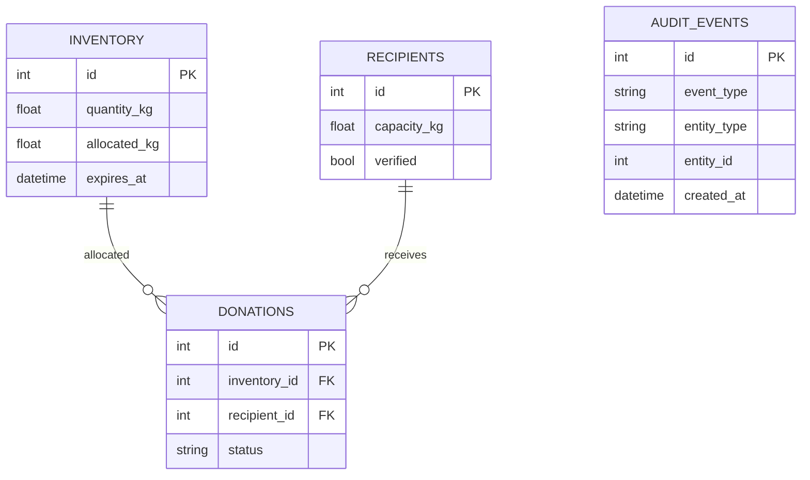

# System architecture

ML predictions are separate from operational listings. FAO publications are a research source, not live inventory.

Donation reservations additionally lock a recipient row and re-check capacity against the sum of active reservations, to avoid oversubscribing a recipient across multiple inventory listings. See [Reservation integrity](RESERVATION_INTEGRITY.md).
